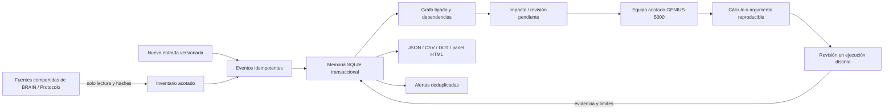

# Arquitectura y responsabilidades

El núcleo GENIUS-5000 procede del commit publicado
`85ecc71f4cc03b62247b9d5f390c6350e185d409` de Conf-Claude-Codex. Se conserva su
registro completo y el SHA-256 en `data/upstream_genius5000.json`. La capa `uft/`
añade investigación integrada, inventario, criterios y actualización incremental.

| Componente | Responsabilidad |
|---|---|
| `genius/catalogue.py` | Generación determinista, 5.000 fichas, diversidad y distribución. |
| `genius/planning.py`, `uft/teams.py` | Funciones del equipo y selección por programa, sin ejecutar perfiles. |
| `genius/orchestration.py` | Subprocesos, concurrencia, presupuestos, reintentos y recuperación. |
| `genius/memory.py` | Afirmaciones y puertas de auditoría para promociones científicas. |
| `genius/cross_review.py` | Cierre de informes, revisión cruzada y desacuerdos persistentes. |
| `uft/inventory.py` | Lectura de lista permitida, procedencia y precedencia de objetivos. |
| `uft/store.py`, `schema.py` | Entidades, enlaces, eventos, invalidación, cobertura y siete criterios. |
| `uft/workflow.py` | Inicialización conservadora y observador finito de archivos. |
| `uft/cycles.py` | Cálculo productor y comprobación independiente en procesos distintos. |
| `uft/reporting.py` | Informe de once secciones, exportaciones y panel local interactivo. |
| `scripts/science_examples.py` | Tres modelos mínimos exactos; no llamadas a un LLM. |
| `scripts/independent_science_audit.py` | Reconstrucción por otra implementación y contraejemplos. |

Los datos portables se guardan en Git: inventario, metas, cálculos, auditorías,
informes y exportaciones. `.uft/research.sqlite` es un índice de trabajo local
ignorado por Git. Los cambios son transacciones y el historial no se sobrescribe.
Una modificación de premisa alcanza transitivamente resultados, enlaces y
evaluaciones; una auditoría de versión anterior no conserva su vigencia.

## Alcance de los controles

El validador detecta campos ausentes, ciclos, IDs repetidos, duplicados textuales,
versiones de evidencia cambiadas y violaciones explícitas de las reglas de estado.
No decide equivalencia matemática, verdad de un artículo, validez de una prueba
arbitraria o completitud de una teoría. Las contradicciones matemáticas nuevas
requieren un argumento o contraejemplo, además de un registro.

Las fuentes canónicas no se modifican. Las alertas UFT y sus exportaciones tienen
namespace propio, evitando confundir incidencias operativas con descubrimientos
que alcancen el umbral científico más estricto de Alertas del BRAIN.
